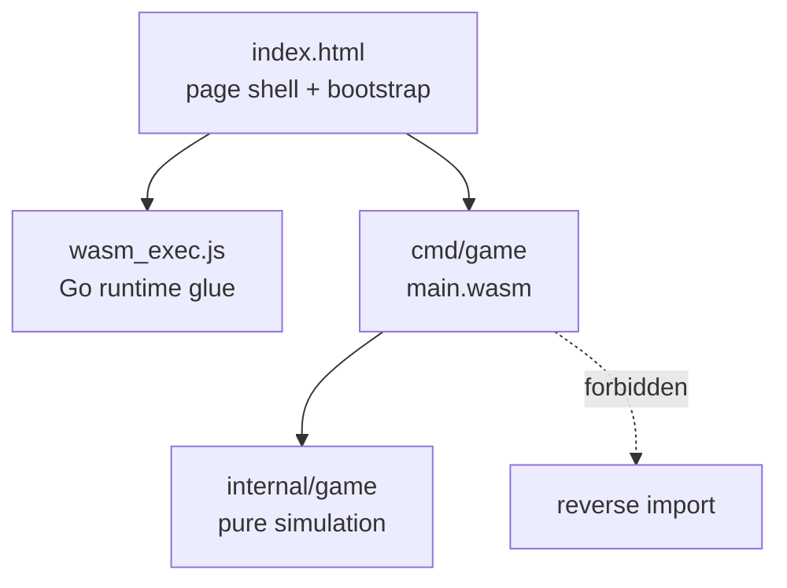

# Architecture — Components

> Current architecture. Dependency direction is one-way, top→bottom.

| Component | Path | Responsibility | May import |
|---|---|---|---|
| Page shell & bootstrap | `index.html` | Canvas element (id `game`, 800×600), load glue, instantiate WASM, show fatal errors | — |
| Entry point | `cmd/game/main.go` | Keyboard capture, requestAnimationFrame loop, `dt` clamping, drawing | `internal/game`, `syscall/js` |
| Simulation | `internal/game/game.go` | State, movement, spawning, collisions, scoring, restart. Zero DOM imports. | stdlib (`math/rand`) only |

## Rules

- `cmd/game → internal/game` only; reverse import forbidden (Constitution §3).
- `internal/game` must never import `syscall/js`, `net/http`, or DOM packages
  (Law 5) — this is what makes it testable with plain `go test`.
- Rendering (`draw` in `main.go`) reads exported state only; it never mutates
  simulation state except by calling `Update`.
- All tunables (speeds, cooldowns, radii, score) live as constants in
  `internal/game`; `cmd/game` contains no game rules (Law 1).

## Planned v0.2 components (not implemented)

| Component | Path (planned) | Responsibility | May import |
|---|---|---|---|
| State machine & menu model | `internal/game/state.go`, `menu.go` | `State` enum, menu list model, transitions, pause freeze | stdlib |
| Lives & respawn | `internal/game/lives.go` | damage arbitration, dying/respawning timers, invulnerability | stdlib |
| Difficulty budgets | `internal/game/difficulty.go` | data tables for budgets and speed scales | stdlib |
| Formation & archetypes | `internal/game/formation.go` | archetype table, slot templates, dive telegraphs | stdlib |
| Wave director | `internal/game/director.go` | seeded selection, validators, stage progression | stdlib |
| Weapons & pickups | `internal/game/weapons.go` | firing modes, power-up timers, drops | stdlib |
| Scoring & ranking | `internal/game/score.go` | combos, bonuses, table ordering/validation | stdlib |
| Sound events | `internal/game/sound.go` | typed `SoundEvent` queue (no DOM) | stdlib |
| Persistence codec | `internal/game/persist.go` | versioned encode/decode + validation of plain structs | stdlib |
| Storage bridge | `cmd/game/storage.go` | `localStorage` read/write via `syscall/js` (ADR-0007) | `internal/game`, `syscall/js` |
| Audio engine | `cmd/game/audio.go` | WebAudio buffers, buses, unlock (ADR-0013) | `internal/game`, `syscall/js` |
| Asset table & fallback | `cmd/game/assets.go` | logical ID → path, decode, geometric fallback (ADR-0011) | `internal/game`, `syscall/js` |

Dependency direction is unchanged: browser services live only in `cmd/game`,
and the simulation receives plain values (bytes, structs, event queues).
Menu selection logic, ranking rules and sound decisions stay in
`internal/game` so they remain unit-testable (NFR-008).

## Rendering model

v0.1: immediate-mode primitives on one canvas each frame — black background,
white player circle, bullet squares, enemy circles, score text or GAME OVER
banner.

v0.2 (planned): the same single immediate-mode pass, extended with sprites that
fall back to those primitives (FR-017), a HUD plate for contrast, and menu
screens drawn from the `State` value (ADR-0010). Text uses a fixed `ctx.font`
set from a Go constant; the canvas id, size and keyboard contract are
unchanged. No camera, no scroll, no second canvas (Law 3).

## Ownership

Single-developer project; every component is owned by the project itself.
Third-party assets are imported at development time and recorded in
`assets/asset-manifest.json` (SEC-004).
