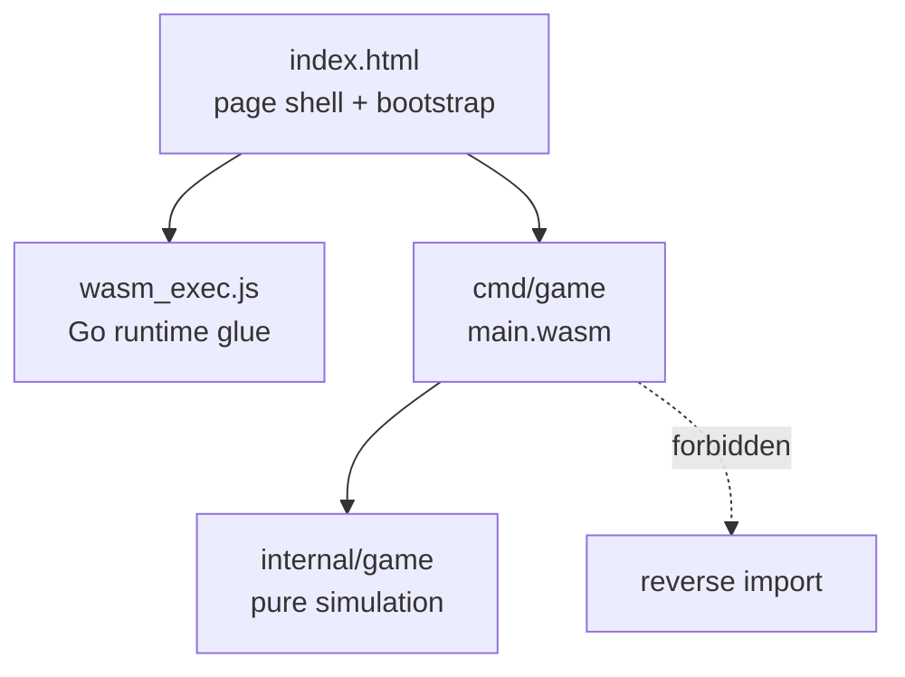

# Architecture — Components

> Current architecture. Dependency direction is one-way, top→bottom.

| Component | Path | Responsibility | May import |
|---|---|---|---|
| Page shell & bootstrap | `index.html` | Canvas element (id `game`, 800×600), load glue, instantiate WASM, show fatal errors | — |
| Entry point | `cmd/game/main.go` | Keyboard capture, requestAnimationFrame loop, `dt` clamping, drawing | `internal/game`, `syscall/js` |
| Simulation | `internal/game/game.go` | State, movement, spawning, collisions, scoring, restart. Zero DOM imports. | stdlib (`math/rand`) only |

## Rules

- `cmd/game → internal/game` only; reverse import forbidden (Constitution §3).
- `internal/game` must never import `syscall/js`, `net/http`, or DOM packages
  (Law 5) — this is what makes it testable with plain `go test`.
- Rendering (`draw` in `main.go`) reads exported state only; it never mutates
  simulation state except by calling `Update`.
- All tunables (speeds, cooldowns, radii, score) live as constants in
  `internal/game`; `cmd/game` contains no game rules (Law 1).

## Rendering model

Immediate-mode drawing on one canvas each frame: black background, white
player circle, bullet squares, enemy circles, score text or GAME OVER banner.
Visual style is intentionally minimal; any richer renderer must stay in
`cmd/game`.

## Ownership

Single-developer project; every component is owned by the project itself.
