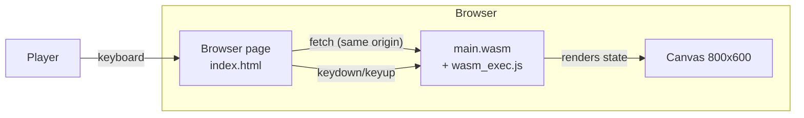

# Architecture — System Context

> Current architecture (documented from code, not aspirational).

## 1. System boundary

Spirit Space is a **single deployable browser application**: static files
served from one origin. There is no server-side component, no database, no
external service.

## 2. Users and external systems

- **Player**: keyboard input, canvas output. The only human actor.
- **External systems**: none. The page fetches only its own assets
  (SEC-002). No network, storage, or analytics.

## 3. Trust boundary

The single trust boundary is the browser sandbox itself. Inside it, a
discipline boundary (Constitution Law 5) separates:

- **`internal/game`** — pure, untrusted-input-free simulation; must never
  touch the DOM. Any dependency of the simulation on DOM/browser state is a
  bug.
- **`cmd/game`** — the only code allowed to read DOM events and draw.

## 4. Failure handling

- Bootstrap errors (fetch/instantiate failure) are caught in `index.html` and
  rendered visibly on the page (Constitution Law 7).
- The render loop clamps `dt` to ≤0.1 s so a long tab pause cannot teleport
  entities (defensive, in `cmd/game/main.go`).
- Panics inside the WASM instance are not recovered; there is no requirement
  to survive them (documented gap — see open questions in product.md).

## 5. Observability

None. No logging, metrics, or tracing exist. Console errors from the bootstrap
script are the only diagnostics. For a client-only game this is a deliberate
minimal choice; any change (e.g. error reporting) would require amending
SEC-002 and the constitution.
