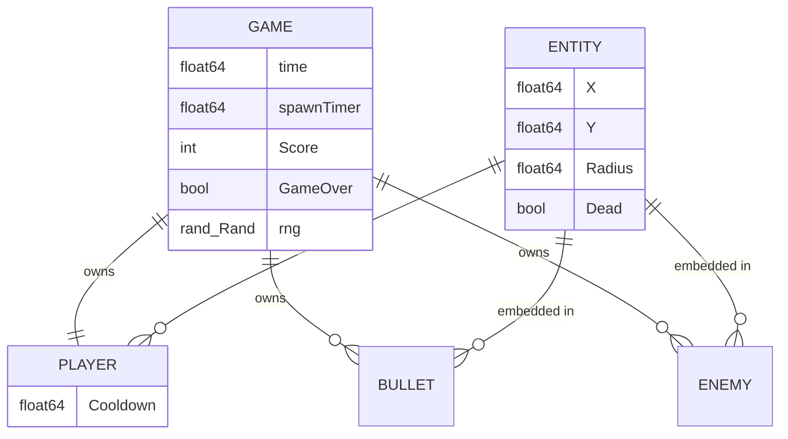

# Architecture — Data Model

> Current architecture. There is no database and no persistence; all state is
> in-memory inside the WASM instance and dies with the page.

## In-memory state (`internal/game`)

| Field | Meaning | Lifecycle |
|---|---|---|
| `Game.Player` | ship position, radius 16, fire cooldown | reset by `Restart()` |
| `Game.Bullets` | live projectiles; despawn above `Y ≤ −20` or on hit | slice reuse via `kept` pattern |
| `Game.Enemies` | live enemies; removed when `Dead` | removed in `handleCollisions` |
| `Game.Score` | points, +10 per kill | reset by `Restart()` |
| `Game.GameOver` | terminal flag; `Update` is a no-op when true | reset by `Restart()` |
| `Game.rng` | seeded (`rngSeed = 1`) source of spawn X positions | recreated on `New()`/`Restart()` |

## Data rules

- No persistence, no serialization, no save/load. High scores are explicitly
  out of scope (gameplay spec v0.1).
- Determinism: the only randomness is the seeded RNG (NFR-001). Two runs with
  identical input sequences produce identical states.
- Death handling: entities are marked `Dead` and compacted in the same pass
  that processes collisions; no tombstones persist across frames.

## Migration concerns

None. Any future persistence (e.g. localStorage high scores) would violate
current constitution §6 and require an amendment plus an ADR.
