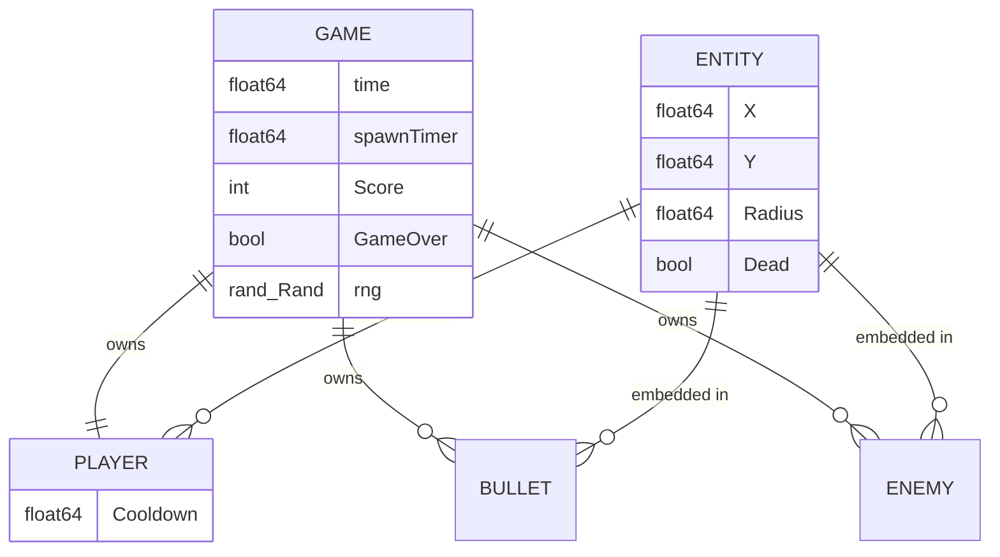
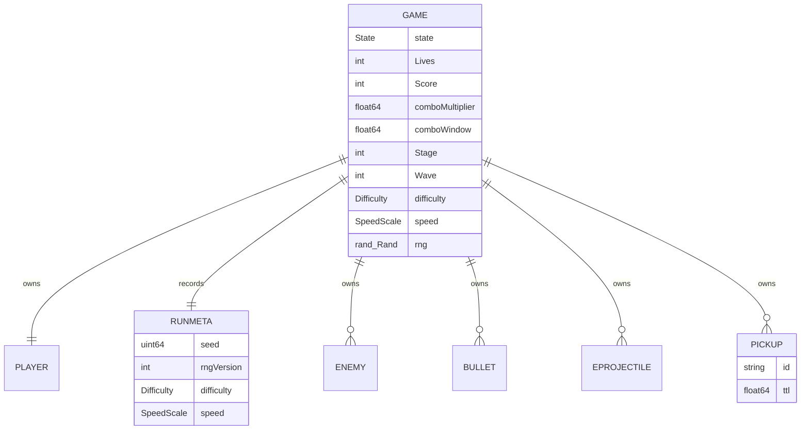

# Architecture — Data Model

> Current architecture. There is no database and no persistence; all state is
> in-memory inside the WASM instance and dies with the page.

## In-memory state (`internal/game`)

| Field | Meaning | Lifecycle |
|---|---|---|
| `Game.Player` | ship position, radius 16, fire cooldown | reset by `Restart()` |
| `Game.Bullets` | live projectiles; despawn above `Y ≤ −20` or on hit | slice reuse via `kept` pattern |
| `Game.Enemies` | live enemies; removed when `Dead` | removed in `handleCollisions` |
| `Game.Score` | points, +10 per kill | reset by `Restart()` |
| `Game.GameOver` | terminal flag; `Update` is a no-op when true | reset by `Restart()` |
| `Game.rng` | seeded (`rngSeed = 1`) source of spawn X positions | recreated on `New()`/`Restart()` |

## Data rules

- **v0.1 (implemented):** no persistence, no serialization, no save/load.
  High scores are out of scope. **v0.2 (planned):** see "Migration concerns"
  and "Planned v0.2 state" below; persistence stays local-only and requires
  the proposed amendment.
- Determinism: the only randomness is the seeded RNG (NFR-001). Two runs with
  identical input sequences produce identical states.
- Death handling: entities are marked `Dead` and compacted in the same pass
  that processes collisions; no tombstones persist across frames.

## Migration concerns

None for v0.1 state. v0.2 adds fields and two persisted documents; both are
versioned and additive:

- New `Game` state: `State`, `Lives`, `RunMetadata`, `PowerUps`, enemy
  projectiles, pickups, `Score` sub-counters (combo multiplier, wave bonus).
  Nothing is removed, so v0.1 fields keep their meaning.
- Persisted documents (`spirit-space.scores.v1`,
  `spirit-space.settings.v1`) are new: no migration from v0.1 exists because
  v0.1 stored nothing. Unknown/older schema versions are discarded on read
  with a clean default (SEC-003), never half-applied.

## Planned v0.2 state (not implemented)

Rules that keep this deterministic and testable:

- `RunMetadata` is immutable after construction (FR-011.7).
- Timers are stored in world seconds and decremented only by fixed steps
  (ADR-0008); pausing stops every timer (FR-006.8).
- Persisted structs contain no DOM types; `cmd/game` converts them to/from
  `localStorage` strings (Law 5).
- Anything persisted is untrusted on read: bounded, versioned, validated,
  defaulted on failure (SEC-003).

## Historical note (v0.1)

The v0.1 text said: "Any future persistence (e.g. localStorage high scores)
would violate current constitution §6 and require an amendment plus an ADR."
Amendment 001 was **ratified 2026-11-12**, so §6 now permits exactly that
narrow case; ADR-0007 is the ADR it anticipated.
